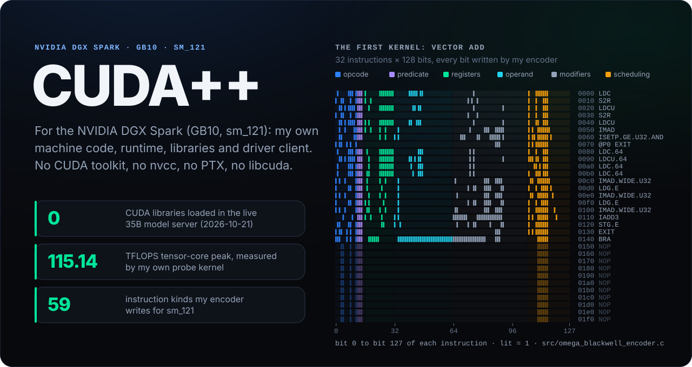
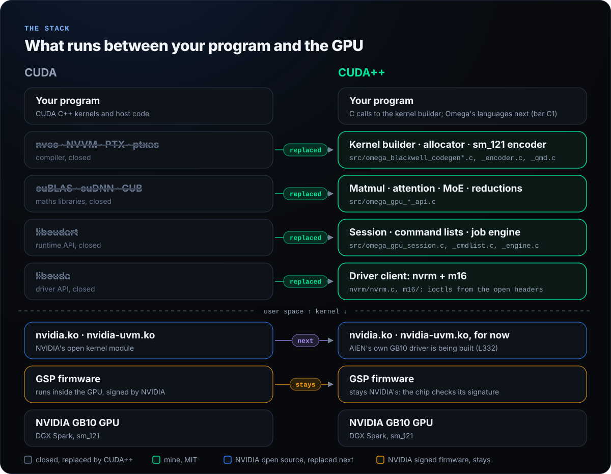
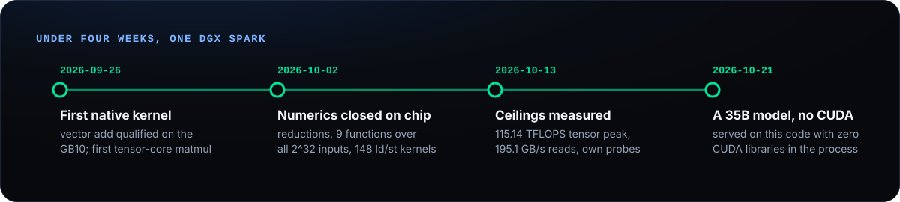
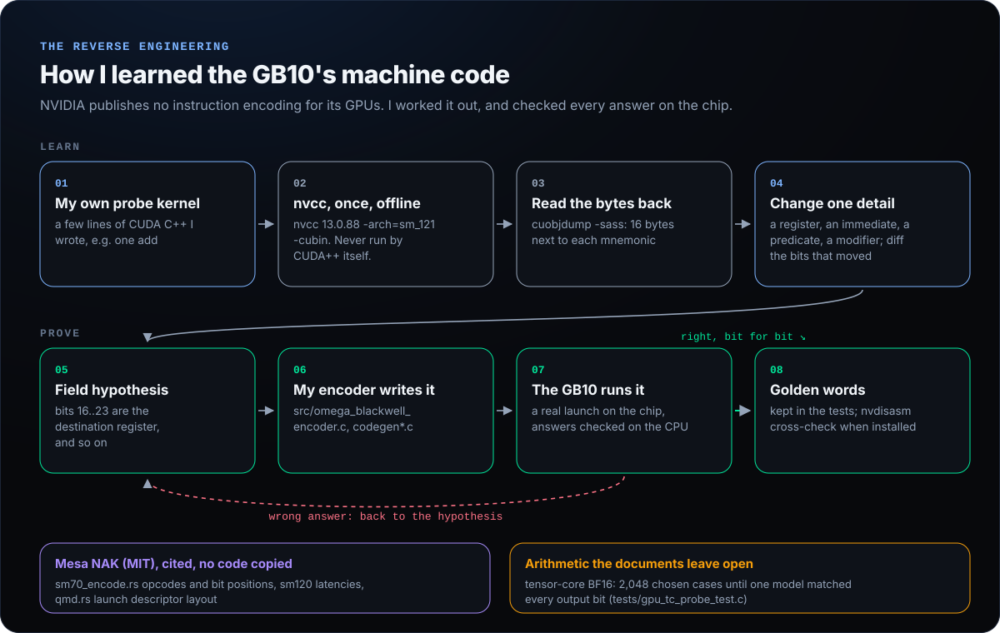
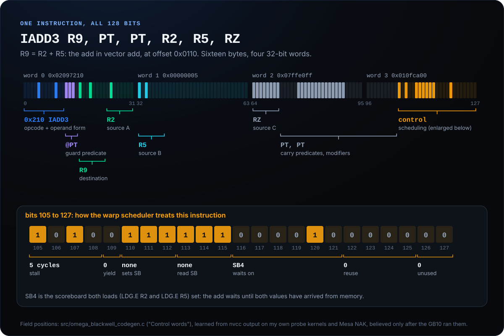
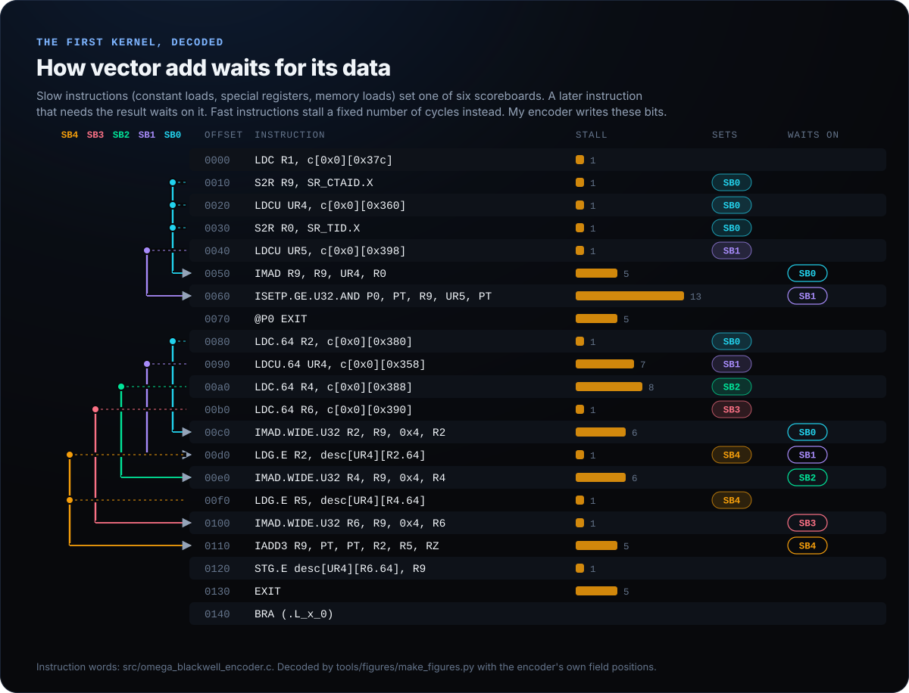
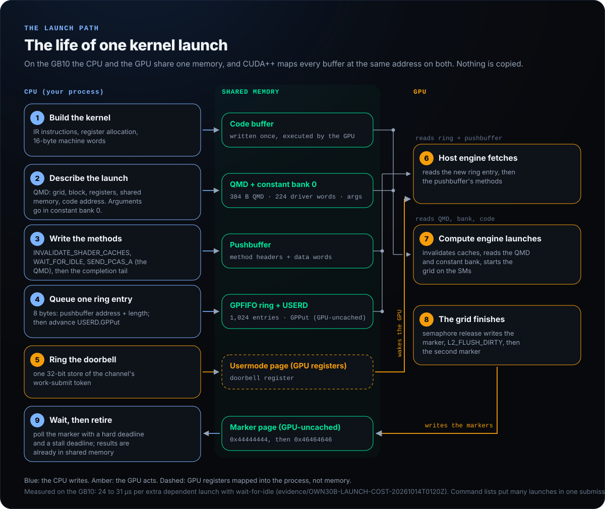
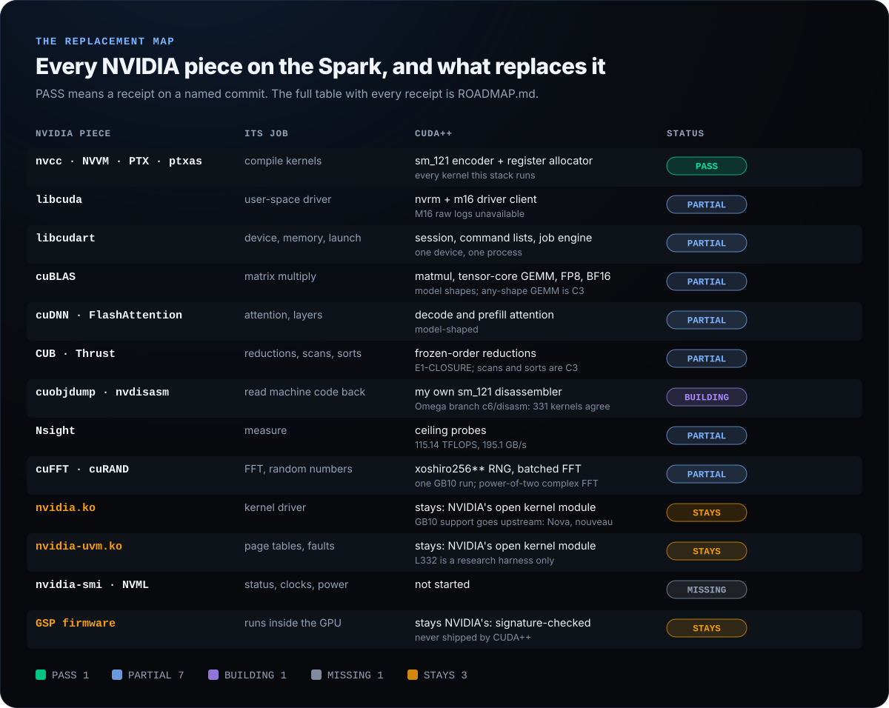
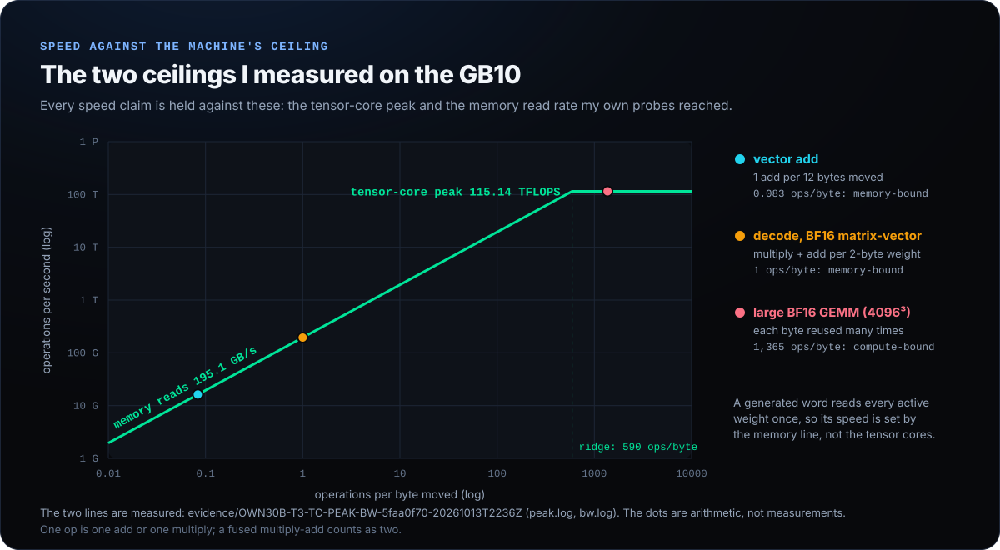

<p align="center">
  
</p>

# CUDA++ for the NVIDIA DGX Spark

**CUDA++ for the NVIDIA DGX Spark (GB10, sm_121). It is the GPU half of the Omega runtime. First-party CUDA++ material in this revision is licensed under Apache-2.0 WITH LLVM-exception.** You write a GPU program, CUDA++ turns it into the GB10's own machine code and runs it on the Spark's GPU, with no NVIDIA user-space software anywhere: no CUDA toolkit, no `nvcc`, no PTX, no `libcuda`, no cuBLAS.

> **Who this is for, and what hardware**
>
> | | |
> |---|---|
> | **Supported** | The NVIDIA DGX Spark. Its GB10 Grace Blackwell chip (GPU compute capability sm_121, PCI id `10de:2e12`) is the only GPU CUDA++ has machine code for. |
> | **Other GB10 systems** | Not run. CUDA++ recognises the GPU by its PCI id, not by the system maker, so another GB10 system with the same kernel module is the same target to the code. Nobody has run CUDA++ on one. |
> | **You need** | Linux on the Spark's ARM CPU (aarch64). NVIDIA's open kernel module, version 580.173.02: `make doctor` and `make hello-gpu` refuse another version, and `/dev/nvidiactl`, `/dev/nvidia0` and `/dev/nvidia-uvm` must exist. NVIDIA's signed GSP firmware, which that module loads into the GPU. `git`, `make` and a C compiler. No CUDA toolkit. |
> | **Not supported** | Other NVIDIA GPUs: PLANNED, not supported. A target row for the RTX 5070 (sm_120) exists on branch `rig/gb20x`, built from public sources and never run on that chip ([portability](docs/runtime/PORTABILITY.md)). AMD and Intel GPUs: not CUDA++ targets. Unmodified CUDA applications: not supported; a CUDA++ program calls CUDA++'s C kernel builder, and CUDA++ does not compile CUDA C++ or PTX. |

> **Licensing status:** This revision uses Apache-2.0 WITH LLVM-exception for first-party material. For the historical MIT version, use [`232332422bfdc31c8918085b50f13c1e18ab702e`](https://github.com/aien-dev/CUDApp/tree/232332422bfdc31c8918085b50f13c1e18ab702e). The old MIT grant and third-party notices are preserved. See [the transition and provenance audit](docs/LICENSING_TRANSITION.md).

It runs on the NVIDIA GB10 (the DGX Spark, compute capability sm_121) today. The 35-billion-parameter model AIEN serves on the Spark runs on this code: on 2026-10-21 the live server had only the C library, the maths library, `libgcc_s` and the loader mapped, and zero CUDA libraries (receipt in Omega: `evidence/WHAT-OMEGA-IS-20261021/live-serve-no-cuda.txt`).

CUDA++ keeps growing until every NVIDIA part on the Spark is replaced, and then does things CUDA does not:

- my own GPU driver replaces NVIDIA's kernel modules `nvidia.ko` and `nvidia-uvm.ko` (AIEN work item L332);
- my own disassembler replaces `nvdisasm`;
- only the GSP firmware stays NVIDIA's, for a physical reason: the GPU checks its signature and boots nothing else;
- beyond CUDA: owning the whole path from program to chip, so one submission per generated word, whole-model kernels that stay resident on the GPU, and zero-copy use of the memory the CPU and GPU share.

CUDA++ is not affiliated with or endorsed by NVIDIA; CUDA is NVIDIA's trademark.

**New to CUDA++?** Start with the [first-run and independent verification guide](docs/START_HERE.md). It separates host-only tests from real GB10 execution, documents the current support boundary, and explains how to interpret receipts. See [contributing](CONTRIBUTING.md), [security reporting](SECURITY.md), and [the readiness roadmap](ROADMAP.md) before relying on it in a deployment.

**On this page:** [the stack](#the-stack) · [how I did it](#how-i-did-it) · [the machine code](#what-the-machine-code-looks-like) · [the driver, part by part](#the-driver-part-by-part) · [one launch, start to finish](#one-launch-start-to-finish) · [CUDA, piece by piece](#cuda-piece-by-piece) · [speed](#speed-against-the-ceiling) · [run your first kernel](#run-your-first-kernel)

## The stack

<p align="center"></p>

Between a CUDA program and the GPU sit four closed NVIDIA layers: the compiler, the maths libraries, the runtime and the driver library. CUDA++ replaces all four with its own code. Under them are NVIDIA's kernel module, whose source NVIDIA publishes, and the firmware inside the GPU. CUDA++ talks to the kernel module directly; AIEN's own driver for the GB10 is being built to replace it.

## How I did it

<p align="center"></p>

I built it alone on one DGX Spark in under four weeks, directing AI coding agents. NVIDIA publishes the source of its Linux kernel module, but not its compiler, its driver library or the GPU's machine code. So I skipped every closed layer:

1. **No libcuda.** I wrote my own client for the open kernel module's ioctls, from its MIT headers: client, device, address space, memory, command ring, compute object, doorbell, completion. [The driver, part by part](#the-driver-part-by-part) shows every piece.
2. **No nvcc, no PTX.** The GPU's machine code is undocumented, so I reverse engineered it: compiled small probe kernels of my own once with NVIDIA's compiler, read the machine code back with NVIDIA's disassembler, compared kernels that differ in one detail to find which bits mean what, cross-checked against Mesa's open NVIDIA compiler, and believed nothing until the chip ran it and gave the right answer. Arithmetic the documents do not pin down (the tensor cores) was measured on the chip until a model matched every output bit.
3. **My own encoder, runtime and libraries** on top: 59 instruction kinds, a register allocator, launch descriptors, command lists, matrix multiply, attention.

<p align="center"></p>

No NVIDIA binary or listing is in this repository. The whole method, step by step with the files and receipts: [docs/HOW_I_DID_IT.md](docs/HOW_I_DID_IT.md).

### What the machine code looks like

Every GB10 instruction is 16 bytes. The low bits say what to do and to which registers; the top 23 bits tell the warp scheduler how long to wait before the next instruction and which earlier results to wait for. Here is the add from the first kernel, every bit accounted for:

<p align="center"></p>

Those scheduling bits are what a compiler normally hides. Slow instructions (memory loads, constant loads, special registers) set one of six scoreboards; a later instruction that needs the result waits on it. Here is the whole first kernel with its waits drawn in:

<p align="center"></p>

Getting one of these bits wrong does not fail loudly: the GPU reads a register before the load has landed and returns a wrong number. That is why every encoding has golden words in the tests and a chip run behind it. The figures on this page are drawn from the repository's own data by `tools/figures/make_figures.py`; the two above decode the words in `src/omega_blackwell_encoder.c`.

## The driver, part by part

`libcuda` is closed, but everything it does to the hardware goes through ioctls on three device files, and NVIDIA's open kernel module defines every one of those calls in its public headers. I copied 67 of those headers unchanged (`third_party/nvidia-open-580.173.02/`, MIT) and wrote my own client against them. This is the whole of it:

<p align="center"></p>

| Part | Where | What it does |
| --- | --- | --- |
| Open | `nvrm_open()` in `nvrm/nvrm.c` | Opens `/dev/nvidiactl` and `/dev/nvidia-uvm`, finds the GPU (`NV_ESC_CARD_INFO`), allocates the root client, device and subdevice, reads the class list to pick the Blackwell classes, reads the SM version and GPU UUID, maps the 64 KiB usermode page that holds the doorbell, and creates an address space that the unified-memory driver manages. |
| Memory | `nvrm_alloc()`, `nvrm_free()` | One system-memory object per buffer. The GB10 has no separate video memory, so each buffer is mapped at the **same address** for the CPU and the GPU: a pointer means the same thing on both sides and nothing is copied. Anything the CPU polls is allocated GPU-uncached (`nvrm_alloc_gpu_uncached()`). |
| Channel | `nvrm_channel()` | Channel group, context share, a command ring of 1,024 entries with its USERD control page, and the Blackwell compute object. Asks for the channel's work-submit token, registers the channel with the unified-memory driver and switches scheduling on. |
| Submit | `nvrm_enqueue()`, `nvrm_ring()` | Writes one 8-byte ring entry (pushbuffer address and length), advances `GPPut` with a full memory barrier, then rings the doorbell: a single 32-bit store of the token. No system call is made to launch work. |
| Wait | `m16/m16_gpu_wait.c` | The one completion wait: polls a word the GPU writes, with a hard deadline that is never extended and a stall deadline that restarts only on progress. |
| Qualification | `m16/m16_requalify.c`, `m16/m16_concurrent.c` | Proofs on the chip. Requalify queues work **without** ringing the doorbell and checks nothing happens for 100 ms, rings it, checks the marker turns to `0x16c0ffee`, and reads `/proc/self/maps` to prove `libcuda` was never loaded. Concurrent runs two channels and checks neither can fire the other. |
| Platform contract | `src/omega_gpu_platform.h` | What the runtime may ask of the machine: typed handles instead of file descriptors, explicit rights on every buffer, no silent fallback. The Linux client above is one implementation; AIEN's own driver plugs in at the same seam. |
| Session, command lists, engine | `src/omega_gpu_session.c`, `src/omega_gpu_cmdlist.c`, `src/omega_gpu_engine.c` | One device per process, kept open; many launches recorded into one submission; a job runner that returns success or exactly one named failure, and refuses all further GPU work if it cannot tell whether the GPU finished. |

What the headers do not say, I learned on the chip and wrote down as rules, each with a receipt or an issue behind it:

- **A word the CPU polls must be GPU-uncached.** Otherwise the GPU keeps the new value in its L2 cache and the CPU never sees it change. This stalled the work once, on 2026-10-02; the platform now refuses such a buffer.
- **New code needs a shader-cache invalidate before it runs.** The GPU's instruction cache does not see CPU writes; after a code address was reused, the chip ran the old instructions. Every launch that uploads code now starts with `INVALIDATE_SHADER_CACHES` (receipt FB1-CUT1B-4345406 in Omega).
- **Dependent launches need a wait-for-idle between them.** Without one, two grids on one channel may overlap. The order of the launch commands follows Mesa's NVK driver.
- **Blackwell's control page reports no read pointer.** The client counts completed ring entries itself and never overruns entries that have not been seen to finish.
- **Creating the compute object needs one free, physically contiguous 2 MiB block** for its context buffer. On a busy host it is briefly missing, so that one allocation is retried, bounded (omega#523).

Under the client: NVIDIA's open kernel module (`nvidia.ko`, `nvidia-uvm.ko`) and the GSP firmware inside the GPU. AIEN's own GB10 driver (L332) is being built to replace the two modules; the firmware stays NVIDIA's because the chip checks its signature. Every object and call in order, with line references: [docs/DRIVER.md](docs/DRIVER.md).

## One launch, start to finish

<p align="center"></p>

The CPU does five things, all of them plain memory writes except the last, which is a single store to a GPU register. The GPU then does the rest on its own: it fetches the ring entry, reads the commands, reads the launch descriptor (the QMD: grid size, block size, registers, shared memory, code address), runs the grid, and writes two completion markers with a cache flush between them. Results are already in memory the CPU can read. Recording many launches into one submission (`src/omega_gpu_cmdlist.c`) is how a whole generated word goes to the GPU at once.

## CUDA, piece by piece

<p align="center"></p>

| CUDA piece | Its job | CUDA++ replacement | Status |
| --- | --- | --- | --- |
| CUDA C++ language | How you write a kernel | The kernel builder (C calls). Omega's languages reaching the GPU is Omega bar C1, built on this toolchain | PARTIAL: C calls only |
| nvcc, NVVM, PTX, ptxas | Compile the kernel to machine code | My own sm_121 encoder and register allocator | PASS: every kernel Omega runs is encoded by it |
| libcuda (driver API) | Talk to the kernel driver | `nvrm` client, ioctls straight to the open kernel module | PARTIAL: implemented; M16 historical summary is unauditable here (see below) |
| libcudart (runtime API) | Device, memory, launch, streams | Session, command lists, job engine | PARTIAL: one device, one process; no streams or events yet; a timeout ends GPU use for the process |
| cuBLAS | Matrix multiply | Matmul, tensor-core GEMM, FP8 and BF16 libraries | PARTIAL: shaped for the models AIEN runs; no any-shape GEMM yet |
| cuDNN, FlashAttention | Attention and network layers | Decode and prefill attention | PARTIAL: model-shaped |
| CUB, Thrust | Reductions, scans, sorts | Frozen-order reductions (`evidence/E1-CLOSURE/`) | PARTIAL: no general scan or sort |
| cuFFT, cuRAND | FFT, random numbers | none yet | MISSING |
| cuobjdump, nvdisasm | Read machine code back | My own sm_121 disassembler | BUILDING: on Omega branch `c6/disasm` (19eebe0e) it agrees with `nvdisasm` on 331 kernels; not in CUDA++ yet. Some host tests here still call `nvdisasm` as a cross-check when it is installed |
| Nsight | Measure | Ceiling probes: 115.14 TFLOPS tensor-core peak, 195.1 GB/s reads (`evidence/OWN30B-T3-TC-PEAK-BW-5faa0f70-20261013T2236Z/`) | PARTIAL: probes, no single tool |
| CUDA samples, docs | Your first kernel | `examples/hello_gpu`, `docs/runtime/` | PARTIAL: one example |
| `nvidia.ko`, `nvidia-uvm.ko` | Kernel driver | AIEN's own GB10 driver (L332), being built | BUILDING |
| GSP firmware | Runs inside the GPU | stays NVIDIA's (signature-checked by the chip) | not replaceable |

PASS means a receipt exists on a named commit. Status words come from Omega's `docs/OMEGA.md`, section 2. `ROADMAP.md` lists every NVIDIA piece on the Spark with its receipt, and the bars CUDA++ must pass before it says "replaces CUDA".

The imported `evidence/m16-blackwell-native-path-requalification-receipt.json`
is an **unauditable historical summary**, not qualification of this checkout.
It names implementation commit `a2c0d7fbc03f7ce91fcb6389312a0ee8630322cd`,
but its `evidence/m16-requalification` raw logs and superseded receipt are absent
from this repository. Its historical PASS and durability fields are preserved
unchanged, not endorsed as current evidence. No immutable durable source for those
missing logs has been established. Current native qualification is **NOT_RUN**;
it needs retained raw logs from a new authorized GPU run, not a host-only check.

## Speed against the ceiling

<p align="center"></p>

Every speed number is held against what this machine can physically do, measured by my own probe kernels. Generating a word of text reads each active weight once and does about one operation per byte, far left of the ridge, so its speed is set by memory, not by the tensor cores. The head-to-head measurement against llama.cpp and vLLM on this Spark is Omega bar P0 (AIEN L394).

## What is in here

| Part | What it does | Where |
| --- | --- | --- |
| GPU toolchain | Writes sm_121 machine code (SASS) directly: a kernel builder with 59 instruction kinds, a register allocator, the instruction encoder, launch descriptors (QMD) | `src/omega_blackwell_codegen*.c`, `src/omega_blackwell_encoder.c`, `src/omega_blackwell_qmd.c` |
| GPU runtime | Opens the device, allocates memory, uploads code, launches kernels, records command lists, runs jobs. The job of CUDA's runtime and driver API | `src/omega_gpu_session.*`, `omega_gpu_cmdlist.*`, `omega_gpu_engine.*`, `omega_gpu_platform*` |
| Libraries | Matrix multiply and matrix-vector (BF16, FP8, 4-bit, ternary), attention for decode and prefill, elementwise, mixture-of-experts routing. The job of cuBLAS and cuDNN | `src/omega_gpu_*_api.*` |
| Driver client | Talks to NVIDIA's open kernel module through its ioctls; replaces `libcuda` | `nvrm/`, `m16/` |
| NVIDIA interface headers | The open kernel module's public interface definitions (MIT, unchanged) | `third_party/nvidia-open-580.173.02/` |
| Runtime API | The written, versioned API and its manifest check | `docs/runtime/API.md`, `src/omega_runtime_api.h` |
| Figures | Every picture on this page, drawn from the repository's own data | `tools/figures/make_figures.py`, `docs/img/` |

## CUDA's pain points, and how CUDA++ fixes them

I read what developers write about CUDA and its libraries on GitHub, Reddit, NVIDIA's forums, the PyTorch forum, Hacker News and Stack Overflow, and ranked the problems by how many people they hurt (GitHub issue counts times how badly they hurt). The full research, with 97 sources and every quote checked word for word against its page, is `docs/PAIN_POINTS.md`. How CUDA++ itself was built, reverse engineering included, is `docs/HOW_I_DID_IT.md`.

Each row below gives the pain in a developer's own words, how CUDA++ fixes it, and the command that shows it, with the output it printed on my DGX Spark and the receipt it came from. A row says FIXED only when that command and receipt are on this branch. Where CUDA is still better, `docs/PAIN_POINTS.md` section 4 says so.

### 1. Out of memory, and on the DGX Spark a frozen machine (26,390 GitHub issues say "CUDA out of memory")

**The pain.** "The Spark ships with zero swap. On unified memory a spike goes straight to a global OOM that hard hangs the whole box. No ssh, no ping, needs a power cycle." ([dgx-spark-laguna FINDINGS.md](https://github.com/sudoingX/dgx-spark-laguna/blob/main/FINDINGS.md))

**How CUDA++ fixes it.** On the GB10 the CPU and GPU share one memory, and every CUDA++ buffer is part of it. CUDA++ has no caching allocator, so what a process holds is what it asked for. Before any allocation reaches the driver, CUDA++ checks how much memory the machine has free. If the buffer would leave less than a reserve (4 GiB by default, `CUDAPP_MEM_RESERVE_MIB` to change it, 0 to turn it off), the allocation is refused with a sentence instead of freezing the box.

**The command that shows it** (host test of the runtime on a simulated driver, run on the Spark):

```
$ make build/test_omega_gpu_platform_linux && ./build/test_omega_gpu_platform_linux
...
  refusal: dma_alloc: refused 2.0 MiB: 4.0 GiB of memory is free and CUDA++ keeps 4.0 GiB free (CUDAPP_MEM_RESERVE_MIB=4096), because the CPU and GPU share it and running it out freezes the machine. Free buffers or use a smaller batch.
  session: dma_alloc: refused 2.0 MiB: 4.0 GiB of memory is free and CUDA++ keeps 4.0 GiB free (CUDAPP_MEM_RESERVE_MIB=4096), because the CPU and GPU share it and running it out freezes the machine. Free buffers or use a smaller batch.
PASS D1_MEMORY_RESERVE_REFUSES_BEFORE_THE_DRIVER
test_omega_gpu_platform_linux (reference only, simulated driver): 9 passed, 0 failed
```

Receipts: `evidence/dx/d1-memory/platform-test-spark.txt`, and `evidence/dx/d1-memory/negative-control.txt` (with the check removed, the test fails). **FIXED in the runtime, shown on the host.** Left: the same refusal on the chip itself, inside a GPU window (`docs/issues/D1-memory.md`).

### 2. The version and build matrix (11,034 GitHub issues mention "TORCH_CUDA_ARCH_LIST")

**The pain.** "I don't know a right solution that works for all setups, happy to hear suggestions." (FlashAttention's maintainer, [flash-attention #246](https://github.com/Dao-AILab/flash-attention/issues/246))

**How CUDA++ fixes it.** There is no toolkit version to match: compiler, runtime and libraries are one repository at one commit, built with `make` and a C compiler. The one outside version is NVIDIA's kernel module, whose public headers CUDA++ is built against. `make doctor` checks it and everything else a first run needs. It reads `/proc`, `/sys` and `/dev` only and opens no device. Every problem gets a line saying what is wrong, why and the command that fixes it. **The doctor wrapper** refuses a module of another version; `make hello-gpu` runs that wrapper first. Direct execution of binaries and applications linking the library have **no driver-version or PCI-ID admission guard**. The diagnostic is not a sandbox or current-commit qualification; callers must perform the compatibility preflight themselves and have an authorized GPU window.

**The command that shows it:**

The following excerpts are historical doctor output; current output explicitly
labels the M16 receipt as a historical summary with raw evidence unavailable.

```
$ make doctor
cudapp doctor: is this machine ready for CUDA++?
  info  system: Linux 7.0.0-1019-nvidia aarch64
  ok    NVIDIA kernel module: open module 580.173.02 (CUDA++ speaks 580.173.02)
  ok    device files: /dev/nvidiactl /dev/nvidia0 /dev/nvidia-uvm can be opened by this user
  ok    GPU 000f:01:00.0: NVIDIA GB10 (sm_121), qualified (receipt: evidence/m16-blackwell-native-path-requalification-receipt.json)
  ok    memory: 121.7 GiB shared by the CPU and the GPU, 61.3 GiB available now
  info  CUDA toolkit: not needed and not used by CUDA++ (one is installed at /usr/local/cuda/bin/nvcc; that is fine)
  info  compiler: this doctor was built by 13.3.0; CUDA++ needs only make and a C compiler
READY. Next: make hello-gpu
```

On a machine with the wrong module (one of the nine fake machines `CUDAPP_DOCTOR_SHOW=1 sh tests/doctor/run.sh build/cudapp-doctor` builds):

```
  FAIL  NVIDIA kernel module: version 575.64.05 is loaded; CUDA++ speaks the 580.173.02 interface
        Why: CUDA++ builds its driver calls from the 580.173.02 open-module headers
        (third_party/nvidia-open-580.173.02). The layout of those calls can change between module versions,
        and a wrong layout fails in strange ways, so CUDA++ refuses instead of guessing.
        This is the only version CUDA++ asks you to match: no toolkit, no framework build, no extension build.
        Do this: install the 580.173.02 open kernel module, or port the client to your version
        (CONTRIBUTING.md, "Port a driver version": copy the new headers, rebuild, run make test and make hello-gpu).
```

Receipts: `evidence/dx/d2-doctor/make-doctor-spark.txt`, `evidence/dx/d2-doctor/fake-machines.txt`, `evidence/dx/d2-doctor/negative-control.txt`. **FIXED.**

### 3. Errors reported late, at the wrong call (10,356 GitHub issues mention "CUDA_LAUNCH_BLOCKING")

**The pain.** "In our experience the python stack traces for these types of exceptions are basically always incorrect and pretty worthless." (vLLM's maintainers, [vLLM blog](https://vllm.ai/blog/2025-08-11-cuda-debugging))

**How CUDA++ fixes it.** A CUDA++ launch waits for its own completion by default, so an error comes back from the call that caused it. And the same kernel program runs on CUDA++'s host warp simulator with one flag, where every global access is checked against the buffers the launch was given. A bad access stops the run at that launch and names the kernel, the launch, the instruction, the block and thread, the address, the buffer it missed and by how much, and what to do next.

**The command that shows it** (`--bug=past-end` hands the last launch one element too many, the classic off-by-one):

```
$ build/hello_gpu --sim --bug=past-end
FAULT at launch 8 of 8 of kernel vecadd (simulator): global load outside every buffer
  launch: grid 1025 x 1 blocks of 128 threads, n = 131073, first element 917504
  instruction: 11 of 19, LDG.E (4-byte load)
  thread: block 1024, thread 0 (element 1048576 of the whole job)
  address: 0xeba6fbc6f040 (4 bytes), 0 bytes past the end of buffer a = [0xeba6fb86f040, 0xeba6fbc6f040) (4194304 bytes)
  simulator: MEM at pc 11: global access outside the declared buffers
  next: launch 8 was given n = 131073, and buffer a holds 131072 elements from this launch's first element.
        Fix the launch or the buffer, run hello_gpu --sim until it passes, then run hello_gpu on the GPU.
```

Receipts: `evidence/dx/d3-faults/fault-report-spark.txt`, `evidence/dx/d3-faults/test-hello-sim.txt`, `evidence/dx/d3-faults/negative-control.txt` (with bounds checking off, the fault checks fail). **FIXED on the simulator.** Left: on the chip a faulting kernel still shows up as a launch that never completes, and the process then refuses further GPU work. Reading the GPU's own fault record (`docs/issues/D3-chip-faults.md`) and recovering without a restart (Omega bar C5, ledger L386) are open.

### 4. Builds take hours and ship gigabytes (7,646 GitHub issues match nvcc "compile time")

**The pain.** "For reference I just compiled it on a 2018 Dell laptop (Quadro P1000 GPU) and the build time was about 15 hours." ([flash-attention #1038](https://github.com/Dao-AILab/flash-attention/issues/1038))

**How CUDA++ fixes it.** No per-architecture copies and no template-heavy device compiler: CUDA++ generates each kernel's machine code when the program builds it (row 9), so the library is plain C.

**The command that shows it** (on the Spark, 20 cores, with other builds running: load average 31.31):

```
$ git clone -b dx/pain-points <this repository> cudapp && cd cudapp
$ time make -j20
exit 0, wall 2.034379307 s
$ ls -l build/libcudapp.a
1060126 build/libcudapp.a
$ nm -u build/libcudapp.a | grep -c -i cuda   (CUDA symbols the library needs)
0
```

Receipt: `evidence/dx/pain-points/d5-build-from-empty.txt`. **FIXED for what CUDA++ contains.** This is not like for like: CUDA++'s libraries cover far less than cuBLAS and cuDNN (`docs/PAIN_POINTS.md` section 4).

### 5. A new chip: "no kernel image is available for execution on the device" (4,033 GitHub issues)

**The pain.** "Very frustrating compared to most every other GPU release that has zero day support from cuda/nvcc/pytorch/tensorflow." ([r/LocalLLaMA, on the DGX Spark](https://www.reddit.com/r/LocalLLaMA/comments/1r569eb/psa_nvidia_dgx_spark_has_terrible_cuda_software))

**How CUDA++ fixes it.** CUDA++ writes sm_121 machine code and has a supported-target table. `make doctor` refuses other NVIDIA GPUs by name and PCI id, with what is missing and the steps to port them. `make hello-gpu` runs the doctor first. This is a **wrapper-only compatibility check**, not a library admission guard: direct binaries and library callers can bypass it. A table row is not proof that the current checkout passed its gates; the M16 evidence limitation above applies.

**The command that shows it** (`CUDAPP_DOCTOR_SHOW=1 sh tests/doctor/run.sh build/cudapp-doctor`, the fake machine with a GPU CUDA++ has not qualified):

```
  FAIL  GPU 000f:01:00.0: NVIDIA device 0x2b85 is not one CUDA++ has qualified.
        Why: CUDA++ writes each chip's machine code itself and has run it only on the NVIDIA GB10 (sm_121),
        so it refuses this GPU now instead of failing later with "no kernel image is available".
        What is missing: a target row for this chip, a check that the encoder's instruction words are valid on it,
        its launch descriptor and class numbers, and the hello-gpu qualification run with its receipt.
        What to do: follow docs/runtime/PORTABILITY.md section 5 ("What a new GPU needs") and CONTRIBUTING.md ("Port a chip"),
        or report it with the output of `make doctor` attached.
```

Receipt: `evidence/dx/d2-doctor/fake-machines.txt`. **FIXED in the doctor wrapper only: the refusal.** Direct library admission is not enforced. Not fixed: CUDA++ targets one chip; porting more is open to everyone (`CONTRIBUTING.md`).

### 6. Different answers from the same inputs (5,416 GitHub issues match nondeterministic cuda)

**The pain.** "Completely reproducible results are not guaranteed across PyTorch releases, individual commits, or different platforms." ([PyTorch docs](https://docs.pytorch.org/docs/2.14/notes/randomness.html))

**How CUDA++ fixes it.** CUDA++ adds in a fixed order (no atomics in its reductions, `evidence/E1-CLOSURE/`), so the same inputs give the same bits with no setting to turn on and no speed cost. Every hello-gpu run prints the hash of its output.

**The command that shows it** (two runs):

```
$ build/hello_gpu --sim
output sha256 72d0c1b2928779e83518f0b4c7d101d933cf89f210cd4627e138c33c9ce9b6a6
$ build/hello_gpu --sim
output sha256 72d0c1b2928779e83518f0b4c7d101d933cf89f210cd4627e138c33c9ce9b6a6
```

Receipt: `evidence/dx/d3-faults/hello-sim-spark.txt`. **FIXED on the simulator.** Left: the same two-run check on the chip, for hello-gpu and a matrix-vector job (`docs/issues/D7-same-bits-chip.md`).

### 7. The per-process CUDA tax (3,478 GitHub issues match "CUDA context" memory overhead)

**The pain.** "The CUDA tax, which is 4.6 GB approximately per each model on a DGX spark." ([r/LocalLLaMA](https://www.reddit.com/r/LocalLLaMA/comments/1sqera2/vllm_woes_in_spark))

**How CUDA++ fixes it.** A CUDA++ process loads no CUDA library: AIEN's live 35B server on 2026-10-21 had only the C library, the maths library, `libgcc_s` and the loader mapped (Omega `evidence/WHAT-OMEGA-IS-20261021/live-serve-no-cuda.txt`).

**NOT YET MEASURED.** The memory a CUDA++ process holds beyond its own buffers still needs a number from a chip run (`docs/issues/D8-process-tax.md`).

### 8. Lock-in by licence (2,902 GitHub issues mention ZLUDA)

**The pain.** CUDA's licence: "You may not reverse engineer, decompile or disassemble any portion of the output generated using SDK elements for the purpose of translating such output artifacts to target a non-NVIDIA platform." ([CUDA EULA](https://docs.nvidia.com/cuda/eula/index.html)) And a developer: "I hope someone is working on hardware agnostic solutions, we need more GPUs, not less." ([r/LocalLLaMA](https://www.reddit.com/r/LocalLLaMA/comments/1b6gfjt/cuda_crackdown_nvidias_licensing_update_targets))

**How CUDA++ addresses it.** This candidate uses Apache-2.0 WITH LLVM-exception for first-party material and preserves the earlier MIT grant for its pinned historical snapshot. Reverse engineering CUDA++ output, translating it and porting it to any hardware are allowed under the applicable license (`CONTRIBUTING.md`). Third-party notices remain in force.

**The command that shows it:**

```
$ grep -m1 "^ *Version 3," LICENSE
                       Version 3, 19 November 2007
```

The earlier MIT-era output is retained as a dated receipt at `evidence/dx/pain-points/licence.txt`; it describes the historical tree, not this candidate. The GPU's signed firmware stays NVIDIA's: the chip checks its signature.

### 9. Compiling at run time, and hangs while it compiles (517 GitHub issues match "JIT compilation" hang cuda)

**The pain.** "A deep prefill forces a live JIT for a huge novel shape mid-inference, and that compile or kernel deadlocks the GPU on `sm_121a`." ([dgx-spark-laguna FINDINGS.md](https://github.com/sudoingX/dgx-spark-laguna/blob/main/FINDINGS.md))

**How CUDA++ fixes it.** The kernel builder runs inside the program, calls no outside compiler, keeps no cache directory, and gives the same bytes every time.

**The command that shows it:**

```
$ build/hello_gpu --sim
kernel built in 22 us: 32 instructions, 12 registers, no compiler run, no cache
machine code sha256 6248b8ed338019f75e20b13a8ef7e63b4e35764229e0669ffbe54464353e87d1
$ build/hello_gpu --sim
kernel built in 23 us: 32 instructions, 12 registers, no compiler run, no cache
machine code sha256 6248b8ed338019f75e20b13a8ef7e63b4e35764229e0669ffbe54464353e87d1
```

Receipt: `evidence/dx/d3-faults/hello-sim-spark.txt`. **FIXED for the kernels CUDA++ builds.** The model's larger kernels are built the same way; their build times are not yet printed.

### 10. Closed, model-shaped libraries

**The pain.** "Even worse, if someone accidentally created a kernel with "cutlass" in the name, the driver would apply optimizations that are not safe." ([r/LocalLLaMA](https://www.reddit.com/r/LocalLLaMA/comments/1lx62hd/nvidia_being_nvidia_fp8_is_150_tflops_faster_when))

**How CUDA++ fixes it.** Every CUDA++ library is source in this repository, built by the same kernel builder you can call, with host references and a simulator.

**NOT YET.** CUDA++'s matrix multiply and attention are shaped for the models AIEN runs. Any-shape GEMM, scans and sorts (Omega bar C3) and my own disassembler (bar C6) are ledger L386 (`docs/issues/D11-libraries.md`, `docs/issues/D13-disassembler.md`).

### 11. The incentive: compute sold from data centers

**The pain.** NVIDIA's data-center segment was 92.5% of its revenue last quarter: "Data Center revenue of $89.0 billion" out of $96.2 billion ([NVIDIA, Q2 fiscal 2027](https://nvidianews.nvidia.com/news/nvidia-announces-financial-results-for-second-quarter-fiscal-2027)). A company paid for compute sold has no reason to make the machine you own do the same work with less.

**How CUDA++ answers it.** Measure the work, not the hardware. Every hello-gpu run prints the bytes it moved, the operations it did, and the least time those bytes need at this machine's own measured ceiling, so less work per answer is a number in front of the developer.

**The command that shows it:**

```
$ build/hello_gpu --sim
work: 12582912 bytes moved (8388608 read, 4194304 written), 1048576 floating-point operations
      at the GB10's measured 195.1 GB/s read ceiling this needs at least 64.5 us
```

Receipt: `evidence/dx/d3-faults/hello-sim-spark.txt`; the ceiling, `evidence/OWN30B-T3-TC-PEAK-BW-5faa0f70-20261013T2236Z/`. **FIXED on the simulator.** Left: the measured GPU time printed next to the floor, from a chip run (the code prints it; it has not run on the chip yet).

Replacing a developer's CUDA libraries and NVIDIA's kernel module with CUDA++ is ledger item L401; its section here comes with it.

## Run your first kernel

You need: a DGX Spark (GB10) running Linux with NVIDIA's open kernel module loaded (version 580.173.02 was used here; `/dev/nvidia0` and `/dev/nvidia-uvm` must exist), plus `git`, `make` and `gcc`. Nothing from the CUDA toolkit is needed or used.

From an empty folder:

```bash
git clone https://github.com/aien-dev/CUDApp
cd CUDApp
make hello-gpu
```

`make hello-gpu` first runs `make doctor`, which checks the machine and names any problem with its fix, then builds the library and `examples/hello_gpu` and runs it. `build/hello_gpu --sim` runs the same kernel on the host simulator with no GPU. The program builds a vector-add kernel, adds two arrays of one million numbers on the GPU and checks every answer on the CPU. It prints `PASS` and exits 0 when all answers are right, exits 1 when any is wrong, and exits 2 when it cannot use the GPU. `examples/hello_gpu/hello_gpu.c` explains each of its five steps.

## Build and test without a GPU

```bash
make          # build/libomega_gpu.a (also as build/libcudapp.a)
make test     # every host-only check: encoder goldens, simulators, refusals, mutation tests
python3 tools/figures/make_figures.py --check   # the figures on this page match the code they are drawn from
make doctor   # is this machine ready? one line per check, each problem with its fix; opens no device
```

`make test` opens no device. The chip gates (`./build/gpu_*_test --out receipt.json`) need a GB10; each test's comment in the `Makefile` says how it is run.

`make test-gemm-selectors` is the focused host-only CLI regression for PFGEMM,
QGEMM and FP8GEMM. Each validates `--shape` before host/simulator/chip work or
receipt creation; unknown, empty and case-mismatched selectors exit 2 with INVALID,
never PASS. PFGEMM/QGEMM accept `gateup`, `down`, `qkv`, `o`; omission runs all.
FP8GEMM also accepts `d768` and `all` (the four standard shapes, not `d768`).
No selected mode/cases/checks yields NOT_RUN rather than a zero-case PASS.
Invalid FP8GEMM input leaves an existing `--out` file untouched. These refusal
tests and doctor tests do not qualify GPU execution. Their before/after output
is retained in `evidence/security-host-20261026/`; the full host suite and GPU
gates were NOT_RUN for this repair.

## How it fits with Omega

[Omega](https://github.com/aien-dev/omega-mv) owns AIEN's seeded `.om` language and its compiler/runtime work. CUDA++ is the GPU toolchain and runtime component it consumes. The currently shipped CUDApp implementation still contains first-party C; the planned, test-gated replacement with native `.om` is tracked in [#79](https://github.com/aien-dev/CUDApp/issues/79). Omega uses CUDA++ at a pinned commit (`cudapp.lock` in Omega), the same way it pins its other parts. The code was split out of Omega on 2026-10-21 with its full history; `docs/AUDIT.md` records how, and what was checked before it was published.

## Names

The C names still carry the `omega_` prefix they had inside Omega, so Omega's work in progress carries over unchanged (`tools/extract/carry.sh`). `docs/NAMING.md` has the plan for the `cudapp` names.

## Licence

First-party material at this revision is Apache-2.0 WITH LLVM-exception ([LICENSE](LICENSE)); third-party terms and notices are in [THIRD_PARTY.md](THIRD_PARTY.md). The earlier MIT grant is documented in [the licensing transition](docs/LICENSING_TRANSITION.md) and the [license at the pinned historical MIT commit](https://github.com/aien-dev/CUDApp/blob/232332422bfdc31c8918085b50f13c1e18ab702e/LICENSE).
