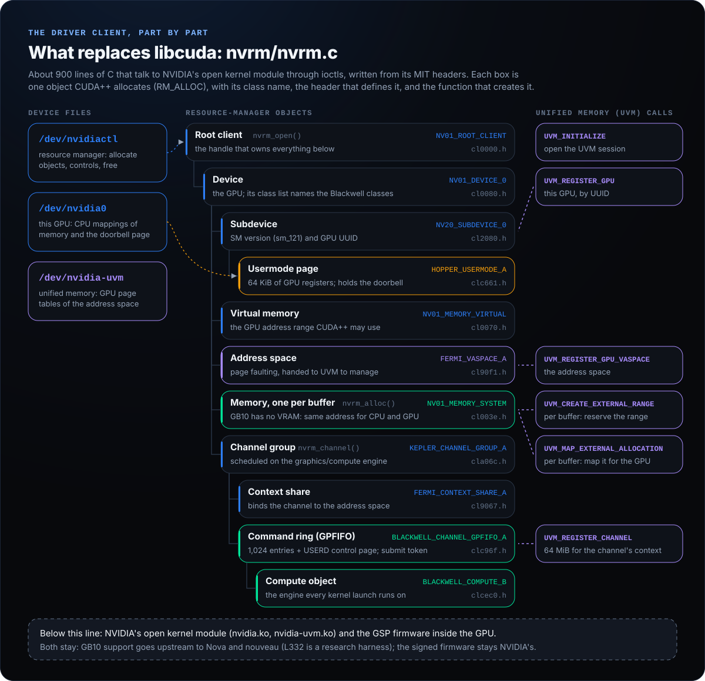

# The driver client, call by call

This is what replaces `libcuda`: `nvrm/nvrm.c` (about 900 lines) and the qualification programs in `m16/`. They talk to NVIDIA's open kernel module, version 580.173.02, through the ioctls its public headers define (`third_party/nvidia-open-580.173.02/`, MIT, unchanged). Line numbers below are for `nvrm/nvrm.c` on the commit that added this file.

## The three device files

| File | Opened by | Used for |
| --- | --- | --- |
| `/dev/nvidiactl` | `nvrm_open()` | The resource manager (RM): every object is created with `NV_ESC_RM_ALLOC`, configured with `NV_ESC_RM_CONTROL` and destroyed with `NV_ESC_RM_FREE`. |
| `/dev/nvidia<minor>` | `open_dev_fd()` (line 231), registered with `NV_ESC_REGISTER_FD` | CPU mappings of memory and of the usermode register page (`NV_ESC_RM_MAP_MEMORY`, then `mmap`). |
| `/dev/nvidia-uvm`, opened twice | `nvrm_open()` | The unified-memory driver, which owns the GPU page tables of the address space. |

## 1. Open: `nvrm_open()` (line 293)

In order:

1. Reserve a slot of virtual addresses for this process, then open `/dev/nvidiactl` and `/dev/nvidia-uvm`.
2. `RM_ALLOC NV01_ROOT_CLIENT`: the root handle. Everything below hangs off it and is freed with it.
3. `UVM_INITIALIZE`, then `UVM_MM_INITIALIZE` on the second UVM file (a failure there is tolerated, as `libcuda` tolerates it).
4. `NV_ESC_CARD_INFO` lists the GPUs; take the first valid one and open its device file.
5. `RM_CONTROL NV0000_CTRL_CMD_GPU_GET_ID_INFO_V2` gives the device instance.
6. `RM_ALLOC NV01_DEVICE_0`, then `NV20_SUBDEVICE_0`, then `NV01_MEMORY_VIRTUAL` (the GPU address range).
7. `RM_CONTROL NV0080_CTRL_CMD_GPU_GET_CLASSLIST`, called twice (count, then list). The client looks for three classes and refuses to go on without them: `BLACKWELL_COMPUTE_B`, `BLACKWELL_CHANNEL_GPFIFO_A` and `HOPPER_USERMODE_A`.
8. `RM_ALLOC HOPPER_USERMODE_A` under the subdevice and map 64 KiB of it. The doorbell is the word at `NVC361_NOTIFY_CHANNEL_PENDING` inside that page.
9. `RM_CONTROL NV2080_CTRL_CMD_GR_GET_INFO` reads the SM version (sm_121 on the GB10).
10. `RM_ALLOC FERMI_VASPACE_A` with page faulting on and `IS_EXTERNALLY_OWNED`, so the unified-memory driver manages it.
11. `RM_CONTROL NV2080_CTRL_CMD_GPU_GET_GID_INFO` reads the GPU UUID, then `UVM_REGISTER_GPU` and `UVM_REGISTER_GPU_VASPACE` hand the GPU and the address space to UVM.

## 2. Memory: `nvrm_alloc()` (line 546) and `nvrm_free()` (line 624)

The GB10 has no separate video memory; the CPU and GPU share one LPDDR5X memory. Each buffer is:

1. a range taken from the process's free list and reserved on the CPU side with `mmap(MAP_FIXED_NOREPLACE)`, so nothing else can land there;
2. `RM_ALLOC NV01_MEMORY_SYSTEM` (non-contiguous, PCI location, GPU-cacheable or not);
3. mapped for the CPU at exactly that address (`NV_ESC_RM_MAP_MEMORY` and `mmap`);
4. mapped for the GPU at the same address: `UVM_CREATE_EXTERNAL_RANGE`, `NV_ESC_RM_MAP_MEMORY_DMA`, `UVM_MAP_EXTERNAL_ALLOCATION` (line 498).

So the CPU pointer and the GPU address of a buffer are the same number. Nothing is copied between a "host" and a "device" copy, because there is only one copy.

`nvrm_alloc_gpu_uncached()` (line 554) makes the GPU skip its L2 cache for the buffer. Anything the CPU polls while the GPU writes it (completion markers, semaphores, the command ring) must be allocated this way; the platform contract refuses a host-polled buffer that is not (`src/omega_gpu_platform.h`).

`nvrm_free()` undoes the four steps in reverse and returns the range to the free list. It refuses a stale or duplicate handle without calling the driver. If any step fails half way, the allocation is quarantined rather than reused, because the driver's state is then unknown.

## 3. The channel: `nvrm_channel()` (line 695)

1. `RM_ALLOC KEPLER_CHANNEL_GROUP_A` on the graphics/compute engine, then `FERMI_CONTEXT_SHARE_A` bound to the address space.
2. One GPU-uncached 64 KiB buffer holds the command ring (1,024 entries of 8 bytes) followed by its USERD control page; a 1 MiB buffer receives channel errors.
3. `RM_ALLOC BLACKWELL_CHANNEL_GPFIFO_A` with the ring, USERD and error buffer.
4. `RM_ALLOC BLACKWELL_COMPUTE_B` under the channel. This one allocation needs one free, physically contiguous 2 MiB block of host memory for the channel's context buffer. On a long-running host that block can be missing for a few hundred milliseconds, so `NV_ERR_NO_MEMORY` here, and only here, is retried: 50 times at 100 ms (`NVRM_CHANNEL_NO_MEMORY_RETRIES`, omega#523). Every other error is final at once.
5. `RM_CONTROL NVC36F_CTRL_CMD_GPFIFO_GET_WORK_SUBMIT_TOKEN`: the number the doorbell is rung with.
6. `UVM_REGISTER_CHANNEL` with 64 MiB of address space for the channel's context buffers, then `RM_CONTROL NVA06C_CTRL_CMD_GPFIFO_SCHEDULE` switches the channel on.

## 4. Submitting work: `nvrm_enqueue()` (line 818) and `nvrm_ring()` (line 840)

A ring entry is 8 bytes (`nvrm_gp_entry()`, line 810): the pushbuffer's GPU address in the low bits and its length in 32-bit words from bit 42. To submit:

1. refuse if the ring would overrun entries that have not been seen to finish (Blackwell's USERD reports no read pointer, so the client counts: `put` and `retired`);
2. write the entry, `dsb sy`, write the new `GPPut` into USERD, `dsb sy`;
3. ring the doorbell: one 32-bit store of the work-submit token to the usermode page.

There is no system call on this path. The pushbuffer itself is a list of method headers (`nvrm_mthd()` in `nvrm/nvrm.h`) and data words; what goes in it for a kernel launch is in `src/omega_gpu_cmdlist.c` and `src/omega_blackwell_submit.c`.

## 5. Waiting: `m16/m16_gpu_wait.c`

Completion is a word in GPU-uncached memory that the GPU writes with a semaphore release. The one wait primitive has two kinds (an exact value, or a counter that has reached a target, correct across wrap-around) and two bounds: a hard deadline that is never extended and a stall deadline that restarts only when a watched word changes. A memory barrier runs before every read. A wait that times out is reported as uncertain: the session then keeps every buffer and refuses all further GPU work in the process, because the GPU may still be running.

## 6. Proof on the chip: `m16/`

- `m16_requalify.c`: queue a semaphore release without ringing the doorbell and check the marker stays 0 for 100 ms; ring it and check the marker becomes `0x16c0ffee`; read `/proc/self/maps` to prove no `libcuda` was loaded. Receipt: `evidence/m16-blackwell-native-path-requalification-receipt.json`.
- `m16_concurrent.c`: two independent channels; ringing one never runs the other's work.
- `nvrm/lifecycle_gates.c`: `nvrm_free()` on the real chip (address reuse, stale and duplicate handles, CPU unmap) and the counter wait.
- `nvrm/submission_visibility_gates.c`: ring entries and rewritten command buffers published by the CPU are seen by the GPU on the second submission too (before the fix, the second submission stalled on the GB10).

## 7. Above and below the client

Above it, `src/omega_gpu_platform.h` is the contract the runtime is written against: typed handles instead of file descriptors, explicit rights and kinds for every buffer, polling named as polling, and no silent fallback. `src/omega_gpu_platform_linux.c` implements it on this client. The C reference of Aien's own GB10 driver (L332, aienux#441) implements the same contract in a simulator.

Below it, today, NVIDIA's open kernel module (`nvidia.ko`, `nvidia-uvm.ko`) does the rest: it boots the GPU's GSP firmware, builds page tables and schedules channels. Aien's own GB10 driver replaces that module (aien-dev/aien-gpu, aien-dev/omega-gpu-driver, aienux#441; BUILDING in `ROADMAP.md`, nothing run on the GB10 yet). This client speaks NVIDIA's ioctl interface, so it has to move onto that driver's interface; that move is PROPOSED. The firmware stays NVIDIA's; the chip checks its signature.
